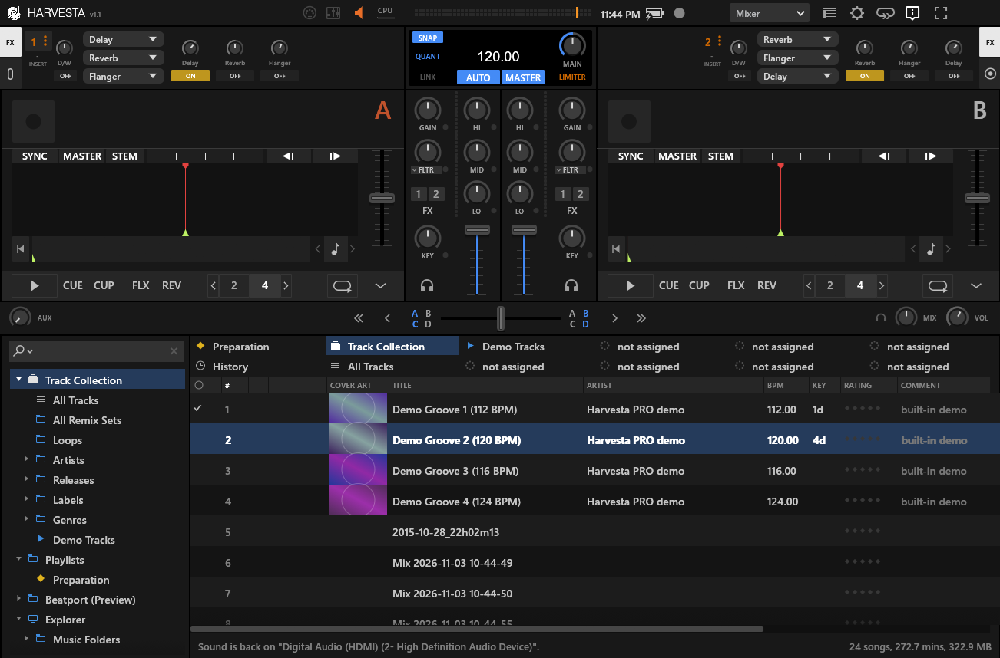

  <picture>
    <source media="(prefers-color-scheme: dark)" srcset="harvesta-logo-white.png">
    <source media="(prefers-color-scheme: light)" srcset="harvesta-logo-black.png">
    
  </picture>

# Harvesta: professional DJ software

**DJ software for Windows 10 and 11, with built-in stem separation.** Mix on four
decks with a DJ mixer or MIDI controller, split tracks into drums, bass, vocals and other, and get
tempo (BPM), key and beat grid analysis. Effects, a Loop Recorder and a Mix Recorder are included.
No account, no cloud, no subscription.

> **Harvesta 1.1 is here.** Download it from the
> [latest release](https://github.com/nozinoz/harvesta-releases/releases/latest). Features marked ◇ below
> are still to come.

Prepare your library, perform with confidence, and play the whole night on the laptop you already
own. Harvesta brings stems, smart analysis, studio-grade effects and a stable audio engine together
in one program that works completely offline.

**[Download the latest version](https://github.com/nozinoz/harvesta-releases/releases/latest)**  ·  Windows 10 / 11 (64-bit)  ·  Free

  

### New in 1.1
- A guided first-run setup, and a splash image of your own at start.
- The Loop Deck: loops in the library browser that stay in tune when the master tempo changes.
- A tracklist and a .cue sheet for every mix recording.
- A dark-booth display mode (F9) and a cheat sheet of keys and controller buttons (hold F8).
- Pre-gig check "Fix it for me", and much lower CPU use when nothing on screen moves.

See the [release notes](https://github.com/nozinoz/harvesta-releases/releases/latest) for everything.

---

## All a DJ needs

### Four decks, your way
Mix on up to four decks. Choose a Track Deck for full songs, a Stem Deck to work with the parts of
a track, or a Remix Deck to trigger loops and one-shots. Sync, key lock and a precise beat grid keep
every deck in time.

### Stems, built in
Split any track into drums, bass, vocals and other parts, right on your laptop. Mute the vocals,
solo the drums, filter the bass, and build live edits on the fly. No internet connection and no
account needed.

### Analysis you can trust
Harvesta detects tempo, key and loudness, and lays down a beat grid you can mix on. Key detection
is tuned against professional reference analysis, so harmonic mixing works the way you expect.

### Effects for every moment
Delays, reverbs, filters, gaters, phasers, flangers and more, tuned for DJ use. Chain three effects
in Group mode or go deep on a single effect. Changes are smooth and click-free.

### Loop Recorder
Capture loops on the beat from your mix, layer new parts on top, and bring back loops you recorded
earlier in the set. Drag a saved loop straight into a Remix Deck.

### Pattern Player
Add drum patterns that lock to the beat. Build tension, fill a breakdown, or lay down a groove under
an a cappella.

### Mix Recorder
Record your whole set in high quality, ready to listen back or share.

---

## Prepare like a pro

### Bring your library with you
Import your existing collection, with playlists, cue points and beat grids, and start playing
straight away.

### Know what's ready
The Preparation list shows every track that still needs analysing, tagging or stems, and tracks
stem jobs as they run. Walk into the gig knowing your crate is ready.

### Your music, untouched
Harvesta never writes to, moves, renames or deletes your music files. Cue points, grids, tags and
stems are kept in Harvesta's own data folder.

---

## Built for the gig

### Rock-solid performance
Every release is tested on a modest laptop with a three-hour, four-deck soak, stems included,
before it reaches you.

### Your hardware, connected
Use an external DJ mixer or audio interface over ASIO, and connect your MIDI or HID
controllers. Harvesta is tested with a real external mixer and two controllers, with more
controller mappings on the way.

### Updates that respect your set
Harvesta checks for new versions in the background and installs only when you're ready. It never
downloads or installs while a deck is playing.

### Works offline
Everything runs on your laptop, stems included. No sign-in, no cloud, no data collected.

---

## Full feature list

Everything in Harvesta at a glance. Features marked ◇ are on the roadmap and not in this release yet.

| Perform | Prepare and organise | Connect, control and extend |
|---|---|---|
| 4 decks: Track, Stem and Remix Decks | Tempo, key and loudness analysis | External DJ mixers over ASIO |
| Stems: drums, bass, vocals and other | Hybrid key detection matched to pro reference keys | External mixer, tested |
| Per-stem volume, mute and filter, click-free | Drifting-tempo detection ◇ | Two controllers, tested |
| Stems made offline on your laptop | Beat grid tools: move, set downbeat, ×½, ×2, ×⅔ | Generic MIDI controllers with MIDI learn |
| Sync with Master Clock; Sync stays on between tracks | Automatic gain | Soft takeover and all MIDI encoder modes |
| Key lock, spread over every CPU core | Import collections with cues, grids and keys | All-in-one controllers with built-in sound card ◇ |
| Snap and Quantize for cues, loops and jumps | Import iTunes and Apple Music libraries | More controller mappings ◇ |
| Hot cues, beat jump and loops up to 64 beats | Import controller mappings (.tsi) | One Devices page for mixer, controllers and drivers |
| Press the active loop size again to exit the loop | Drag and drop from Windows Explorer | Plug-and-play: known devices set themselves up |
| Delay, Reverb, Flanger, Gater, Beatmasher, Phaser, Filter LFO and more | Preparation list with live stem progress | Controller mapping editor: press a control, click its job |
| Group mode (3 effects) and Single mode | Stems for the whole library, in the background | Every browser action on a key or button |
| Loop Recorder with overdub | Pre-listen tracks on headphones (cue) | Pre-gig check: one click, pass or fix list |
| Loop browser: bring back loops from earlier in the set | Never writes, moves, renames or deletes your music | DJ power mode: no sleep, full speed while you play |
| Pattern Player drum patterns | Collection and play history saved as you go | Offline crash reports, nothing ever sent |
| Mix Recorder, with +24 dB gain and clip meter for external mixers | Search grammar: `bpm:120-126 key:8A` ◇ | Updates never download or install mid-set |
| Mastering suite on the master output ◇ | Smart playlists with nested AND/OR rules ◇ | One-step rollback to the previous version ◇ |
| Limiter with true-peak metering | Custom tag groups ◇ | Scripting: your own actions in Luau ◇ |
| Hi-res colour waveforms | Mix-in and mix-out points with countdown ◇ | Harvesta API over WebSocket and OSC ◇ |
| Track-end warning | Beat normalisation for drifting tracks ◇ | AI assistant via an MCP server, read-only first ◇ |
| Duplicate deck | Set check: is this playlist gig-ready? ◇ | AI drafts: playlists and set orders you approve ◇ |
| Remix Decks with saved loops | Gig library copy, frozen for the night ◇ | VST3 plug-ins as effects and decks ◇ |
| More decks, E to H ◇ | Track identity by audio fingerprint ◇ | CDJs as Harvesta controllers ◇ |
| Drum fills from the track's own drum stem ◇ | Missing-file manager ◇ | CDJ link: share tracks with Pro DJ Link players ◇ |
| Groovebox: live beats and patterns ◇ | Cue offset and copy cues between tracks ◇ | USB export for CDJs ◇ |
| Vocal regions shown from the vocal stem ◇ | Import from and export to rekordbox, Serato and more ◇ | Export a performance as a DAW project ◇ |

---

## Download and install

1. Download **Harvesta-Setup** (for example `Harvesta-Setup-v1.1.exe`) from the [latest release](https://github.com/nozinoz/harvesta-releases/releases/latest).
2. Run it and follow the short setup. Windows may ask for permission to install.
3. Start Harvesta, add your music folder, and let it analyse your tracks.

**System requirements:** Windows 10 or 11, 64-bit. An ASIO audio interface or DJ mixer is
recommended.

**About the Windows warning:** Harvesta isn't code-signed yet, so Windows may show an "unknown
publisher" warning the first time. Select **More info**, then **Run anyway**. Each release lists
its SHA-256 checksum so you can verify the download.

**Stems:** the stem separation model is a separate one-time download from version 1.0.1 onwards.
The release notes explain how to add it.

---

## Release schedule

| Release | Example | What's in it |
|---|---|---|
| **Major** | 2.0 | A new generation of Harvesta |
| **Feature** | 1.1 | New features |
| **Fix** | 1.0.1 | Fixes and improvements |

This page keeps the latest fix of each feature release, plus the final release of each earlier
major version. See each release for its notes.

---

Harvesta is independent software. Product names belong to their owners.
